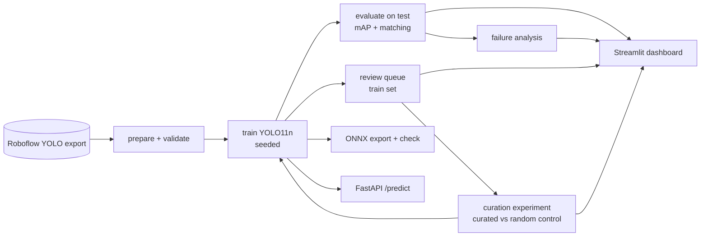

# VisionOps: PCB defect inspection and model improvement

VisionOps fine-tunes a small pretrained YOLO detector to find defects on printed circuit
boards. It then measures where the model fails and uses that to decide which training data a
human should review. A controlled experiment tests whether curating the flagged data helps.

**What it shows**
- Reproducible data setup with label validation and split-leakage checks.
- Seeded fine-tuning of YOLO11n.
- Evaluation on an untouched test set: mAP@50, mAP@50-95, precision, recall, per-class metrics
  and per-image predictions.
- Failure analysis with explicit matching rules: false positives by cause, false negatives by
  cause, low-confidence detections and possible annotation problems.
- A review queue that ranks training images for a human. Low confidence alone never marks a
  label as bad.
- A curation experiment that compares the curated model with a random-removal control on the
  same test set.
- A Streamlit dashboard, a FastAPI `/predict` endpoint and ONNX export with a consistency check.

## Results

Every number below is produced by the pipeline (`python -m visionops.report`). Nothing is typed by hand.

<!-- RESULTS:START -->
_Auto-generated by `python -m visionops.report` from files in `reports/`._

### Dataset
Classes (6): missing_hole, mouse_bite, open_circuit, short, spur, spurious_copper
| split | images | boxes | label issues |
|---|---|---|---|
| train | 1620 | 6889 | 0 |
| val | 180 | 774 | 0 |
| test | 93 | 396 | 0 |

Split method: {'train': 'provided', 'test': 'provided test + provided valid (merged; un-augmented originals)', 'val': 'carved from train (grouped by source image, frac=0.1, seed=43)'}

### Baseline model - held-out test set
Model `yolo11n.pt`, 50 epochs, imgsz 640, seed 42, trained in 28.87 min on NVIDIA GeForce RTX 2060 (torch 2.11.0+cu128, ultralytics 8.3.253).
| mAP@50 | mAP@50-95 | precision | recall | P @conf0.25 | R @conf0.25 | F1 @conf0.25 |
|---|---|---|---|---|---|---|
| 0.601 | 0.249 | 0.543 | 0.578 | 0.804 | 0.321 | 0.458 |

Per class:
| class | instances | precision | recall | map50 | map50_95 | op_f1 |
|---|---|---|---|---|---|---|
| missing_hole | 132 | 0.509 | 0.777 | 0.744 | 0.347 | 0.607 |
| mouse_bite | 97 | 0.625 | 0.443 | 0.506 | 0.206 | 0.216 |
| open_circuit | 46 | 0.628 | 0.348 | 0.532 | 0.162 | 0.222 |
| short | 41 | 0.499 | 0.878 | 0.765 | 0.347 | 0.676 |
| spur | 32 | 0.518 | 0.438 | 0.480 | 0.205 | 0.216 |
| spurious_copper | 48 | 0.479 | 0.583 | 0.577 | 0.229 | 0.478 |

Test images: 93 (3 with no FP/FN at the operating point), GT boxes: 396.
False positives by type: {'duplicate': 23, 'localization': 7, 'class_confusion': 1}. False negatives by type: {'below_threshold': 239, 'missed': 30}.
Low-confidence true positives: 123. High-confidence disagreements flagged for label review: 0.

### Review queue (training set)
1620 training images have at least one review signal; 22 include a possible annotation issue. These are review priorities, not confirmed label errors.

### Curation experiment (same untouched test set)
Not run yet.

### ONNX export consistency
Not run yet.
<!-- RESULTS:END -->

## Architecture



Details: [docs/architecture.md](docs/architecture.md) · Model card: [docs/MODEL_CARD.md](docs/MODEL_CARD.md)

## Quick start (Windows, NVIDIA GPU)

Prerequisites: Python 3.10–3.13, an NVIDIA driver (check with `nvidia-smi`), and Git.

```powershell
git clone https://github.com/<you>/visionops.git
cd visionops
copy .env.example .env      # then set ROBOFLOW_API_KEY (free account: app.roboflow.com -> Settings -> API Keys)
powershell -ExecutionPolicy Bypass -File .\run_pipeline.ps1
```

`run_pipeline.ps1` does the following:
- creates `.venv` and installs CUDA PyTorch plus the requirements
- runs the unit tests
- downloads, prepares and validates the data
- trains and evaluates the baseline
- builds the review queue
- runs the curation experiment
- exports to ONNX and writes the results

It can be resumed: every step is skipped if its output already exists. Progress is logged to
`logs/pipeline.log`.

If you don't want to use an API key, download the **YOLOv8** zip from the
[dataset page](https://universe.roboflow.com/pcbdataset/pcb-defect-detection-9ewqw) and run
`.\run_pipeline.ps1 -DatasetZip C:\path\to\export.zip`.

No GPU? Use `-TorchIndex https://download.pytorch.org/whl/cpu`. Training will run, but slowly.
Reduce `epochs` in `configs/baseline.yaml` to compensate.

## Step-by-step commands (any OS)

```bash
python -m venv .venv && source .venv/bin/activate     # Windows: .venv\Scripts\activate
pip install torch torchvision --index-url https://download.pytorch.org/whl/cu128   # or /cpu
pip install -r requirements.txt                       # optional: pip install -r requirements-optional.txt (MLflow)
pytest -q

python -m visionops.data.download                     # or: --zip path/to/export.zip
python -m visionops.data.prepare                      # frozen split lists -> data/pcb/dataset.yaml
python -m visionops.data.validate                     # -> reports/data_validation.json

python -m visionops.train    --config configs/baseline.yaml --name baseline
python -m visionops.evaluate --weights runs/baseline/weights/best.pt --name baseline
python -m visionops.review   --weights runs/baseline/weights/best.pt

python -m visionops.experiment build --frac 0.05      # or --source reviews (uses dashboard decisions)
python -m visionops.experiment run                    # add --seeds 42 43 44 for a fairer comparison
python -m visionops.export_onnx --weights runs/baseline/weights/best.pt
python -m visionops.report                            # updates README / model card results

streamlit run app/dashboard.py
uvicorn api.main:app --port 8000
```

## API

```bash
curl -F "file=@board.jpg" "http://localhost:8000/predict?conf=0.25"
```
```json
{"filename": "board.jpg", "width": 3034, "height": 1586, "model": "runs/baseline/weights/best.pt",
 "inference_ms": 0.0, "num_detections": 1,
 "detections": [{"class_id": 0, "class_name": "...", "confidence": 0.0, "box_xyxy": [0, 0, 0, 0]}]}
```
The response above shows the schema only; the values are placeholders. `GET /health` reports
whether a model is loaded. Without weights, `/predict` returns `503` with a message instead of
crashing. Set the model with `VISIONOPS_MODEL`.

Docker (CPU, API only; weights mounted at runtime):
`docker build -t visionops-api .` then `docker run -p 8000:8000 -v ${PWD}/runs:/app/runs visionops-api`.

## Dashboard

| Tab | What it shows |
|---|---|
| Inspect image | Upload an image, pick a model and confidence threshold, see boxes and download JSON |
| Evaluation | Headline and per-class metrics, error breakdown, confusion matrix and PR curves |
| Failure gallery | Crops of FNs, FPs, low-confidence TPs and possible annotation issues, filterable by class and subtype |
| Review queue | Ranked training images with reasons and overlays. Decisions (`label_ok` / `label_issue` / `unsure`) are saved to CSV |
| Experiments | Baseline vs curated vs random control on the same test set |

Each tab tells you which command to run if its input files don't exist yet.

## How errors are defined

At the operating point (conf ≥ 0.25), predictions are matched greedily in descending confidence
to the unmatched ground-truth box of the **same class** with the highest IoU ≥ 0.5.

| Outcome | Rule |
|---|---|
| TP | matched as above; flagged *low-confidence* if conf < 0.5 |
| FP - duplicate | overlaps (IoU ≥ 0.5) a same-class GT that was already matched |
| FP - class confusion | overlaps (IoU ≥ 0.5) a GT of another class |
| FP - localization | same-class GT with 0.1 ≤ IoU < 0.5 |
| FP - background | no meaningful overlap with any GT |
| FN - below threshold | a same-class prediction with IoU ≥ 0.5 exists but its conf < 0.25 |
| FN - class confusion / poor localization / missed | analogous to the FP cases |

**Possible annotation issues** are raised only when the model disagrees with the label at
**high confidence (≥ 0.7)**:

| Model output | Flag |
|---|---|
| Background FP | possible missing label |
| Class confusion | possible wrong class |
| Localization error | possible loose box |

The labels are also checked for:
- duplicate boxes (same class, IoU ≥ 0.9)
- per-class geometric outliers (robust z-score > 3.5 on log area or log aspect ratio)

These are review prompts, not verdicts.

**Review priority** is a weighted sum of these signals (`visionops/analysis.py:DEFAULT_WEIGHTS`).
Annotation suspicions weigh most. A low-confidence correct detection weighs 0.25 and can never
mark an image as a possible annotation issue on its own. Training-set predictions are in-sample,
so errors are under-counted. Any disagreement that survives training is still worth a look.

## Curation experiment design

- **Baseline:** the full training split.
- **Curated:** the training split minus the top-ranked images with a possible annotation issue,
  capped at `--frac` of the training set. All Roboflow-augmented copies of a flagged photo are
  removed together.
- **Random control:** the same number of images removed at random (seeded).

All three variants share the same config, seed, validation list and test list. Only `train.txt`
differs, and the test set never influences flagging. Use `--seeds` to train each variant with
several seeds, because a single-seed difference may be noise. With `--source reviews`, the curated
set instead removes the images you marked `label_issue` in the dashboard. That gives you a
human-in-the-loop version of the same experiment.

## Project layout

```
visionops/        core package (boxes, matching, analysis, data/, train, evaluate, review, experiment, export_onnx, report)
api/main.py       FastAPI app
app/dashboard.py  Streamlit app
configs/          training/eval config
tests/            pytest suite (core logic runs without torch/GPU)
docs/             architecture + model card
reports/          generated metrics, analyses and plots (committed); large CSVs ignored
run_pipeline.ps1  one-command Windows pipeline
```

Data, weights (`*.pt`, `*.onnx`), `runs/`, `mlruns/` and `.env` are git-ignored.

## Limitations

- Public dataset of limited size. Results won't necessarily transfer to other boards, cameras or lighting.
- Default 640 px input may under-resolve the smallest defects. Try `imgsz: 1024` if you have the GPU memory.
- GPU training isn't bit-for-bit deterministic even with seeds.
- MLflow tracking is optional and best-effort. The JSON reports in `reports/` are the source of truth.
- The Dockerfile (API only) has not been built or tested as part of the recorded runs.

## Dataset and licences

- Dataset: [PCB Defect Detection](https://universe.roboflow.com/pcbdataset/pcb-defect-detection-9ewqw)
  by the `pcbdataset` workspace on Roboflow Universe, **CC BY 4.0**. The dataset isn't included in
  this repository.
- Ultralytics YOLO is AGPL-3.0. VisionOps source code is MIT (see `LICENSE`).
