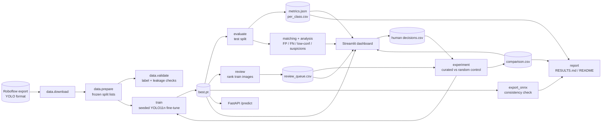

# Architecture

VisionOps is a small set of Python modules joined by files on disk. There is no
database, message queue or service mesh: each stage reads the previous stage's
outputs, so any step can be re-run on its own.

| Module | Responsibility | Needs torch |
|---|---|---|
| `visionops/boxes.py` | YOLO label parsing + validation, coordinate conversion, IoU | no |
| `visionops/matching.py` | Prediction-to-GT matching rules and error taxonomy | no |
| `visionops/analysis.py` | GT loading, per-image events, operating-point metrics, geometry/duplicate checks, review ranking | no |
| `visionops/data/*` | Download, split preparation, dataset validation | no |
| `visionops/inference.py` | `Detector` wrapper (.pt or .onnx), drawing helpers | yes |
| `visionops/train.py` / `evaluate.py` / `review.py` / `experiment.py` / `export_onnx.py` | Pipeline CLIs | yes |
| `visionops/report.py` | Builds RESULTS.md from produced files only | no |
| `visionops/tracking.py` | Optional MLflow logging, no-op when unavailable | no |
| `api/main.py` | FastAPI `/health`, `/predict` | yes (at request time) |
| `app/dashboard.py` | Streamlit UI | yes (for live inference only) |

Design choices:
- **Split lists, not copies.** Splits and experiment variants are `.txt` lists of image
  paths. Curation never touches the files, and every variant references the same
  `val.txt` and `test.txt`.
- **Two metric views.** mAP/P/R come from the Ultralytics validator (standard, conf=0.001).
  Error analysis uses an explicit operating point (conf=0.25, IoU=0.5) so every FP/FN
  can be traced to an image.
- **Torch-free core.** Matching, analysis and data checks are pure numpy/pandas and are
  unit-tested without a GPU.
